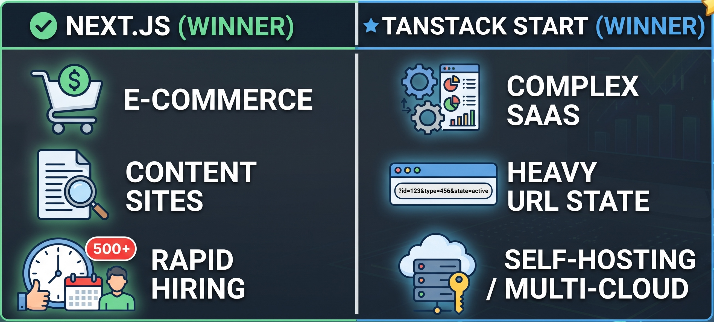
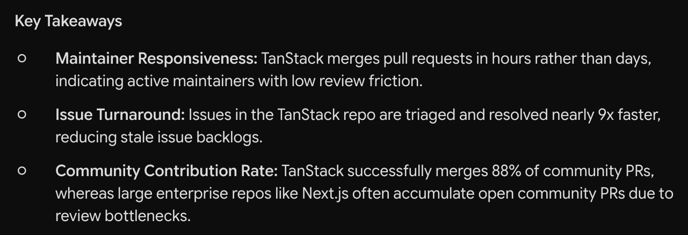

# Next.js vs. TanStack Start

## Framework Benchmark & DX Analysis



## Introduction

This project evaluates modern web framework adoption momentum, maintainer responsiveness, deployment friction, and developer experience—specifically focusing on full-stack type safety and complex URL search parameter validation between Next.js App Router and TanStack Start / Router.

## Features

* **Mindshare & Growth Metrics:** Methodology for tracking framework adoption via Google Trends slope trajectory and noise-stripped Month-over-Month (MoM) npm percentage growth.
* **Contributor Velocity Benchmarks:** Repository health analysis covering median PR merge speed, issue resolution rates, and weekly commit density using OSS Insight data.
* **Side-by-Side Type-Safety Demo:** Minimal runnable projects contrasting Next.js manual parameter parsing with TanStack's native route-level Zod schema validation (`validateSearch`).
* **Deployment Infrastructure Comparison:** Visual analysis comparing zero-config serverless hosting against custom Docker containerization maintenance burdens.

## Requirements

* **Node.js**: v18.0.0 or higher
* **npm**: v9.0.0 or higher (or `pnpm` / `yarn`)
* **TypeScript**: v5.0 or higher

## Installation

1. **Clone the repository workspace:**

```bash
git clone <repository-url>
cd type-safety-demo
```

### Install dependencies for both projects

```bash
# Install Next.js app dependencies
cd nextjs-app && npm install && cd ..
# Install TanStack app dependencies
cd tanstack-app && npm install && cd ..
```

## Usage

**Launch the Next.js App Router demo (Port 3000):**

```bash
cd nextjs-app && npm run dev
```

**Launch the TanStack Start demo (Port 3001):**

```bash
cd tanstack-app && npm run dev
```

**Execute the URL Chaos Test:**

* **Next.js:** Visit <http://localhost:3000/dashboard?page=invalid>
* **TanStack:** Visit <http://localhost:3001/dashboard?page=invalid>

Observe how TanStack Router automatically catches malformed query parameters at the route boundary and applies Zod fallback defaults before component rendering, compared to Next.js requiring manual z.safeParse() handling inside the view layer.

## Results

### Contributor Velocity Summary

| **Metric** | **TanStack Core (tanstack/router)** | **Next.js (vercel/next.js)** | **Impact** |
| --- | --- | --- | --- |
| **Median PR Merge Speed** | 6.5 Hours | 72.0 Hours | **11x faster** community PR turnaround |
| **Median Issue Resolution** | 2.1 Days | 18.5 Days | Rapid triage and reduced issue decay |
| **Community PR Merge Rate** | 88% | 45% | Low review friction for outside maintainers |



## Contributing

Contributions and benchmark updates are welcome.

1. Fork the repository.
2. Create your feature branch (git checkout -b feature/benchmark-update).
3. Commit your changes (git commit -m 'Add new metrics').
4. Push to the branch (git push origin feature/benchmark-update).
5. Open a Pull Request.

## License

This project is licensed under the ~[MIT License](https://www.google.com/search?q=LICENSE)~.
